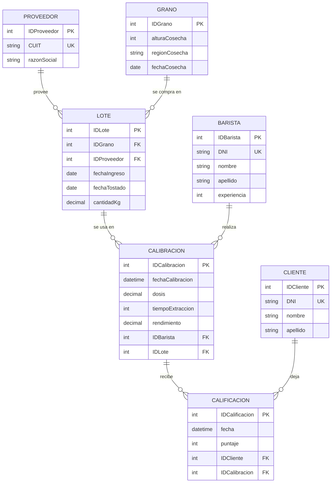

# Cafetear: DER



## Modelo relacional

```
Proveedor (IDProveedor PK IDENTITY, CUIT UNIQUE NOT NULL, razonSocial)
Grano (IDGrano PK, alturaCosecha, regionCosecha, fechaCosecha)
Lote (IDLote PK, IDGrano FK, IDProveedor FK, fechaIngreso, fechaTostado, cantidadKg)
Barista (IDBarista PK IDENTITY, DNI UNIQUE NOT NULL, nombre, apellido, experiencia)
Calibracion (IDCalibracion PK, fechaCalibracion, dosis, tiempoExtraccion, rendimiento, IDBarista FK, IDLote FK)
Cliente (IDCliente PK IDENTITY, DNI UNIQUE NOT NULL, nombre, apellido)
Calificacion (IDCalificacion PK, fecha, puntaje, IDCliente FK, IDCalibracion FK)
```

## Unidades de Calibracion

- `dosis`: gramos de café molido.
- `tiempoExtraccion`: segundos.
- `rendimiento`: gramos de café líquido en la taza.
- La relación de extracción (rendimiento / dosis, por ejemplo 1:2) se calcula en las consultas y no se guarda.

## Alcance

Sin blends: cada calibración usa un único lote. Las mezclas de granos quedan como mejora futura.
